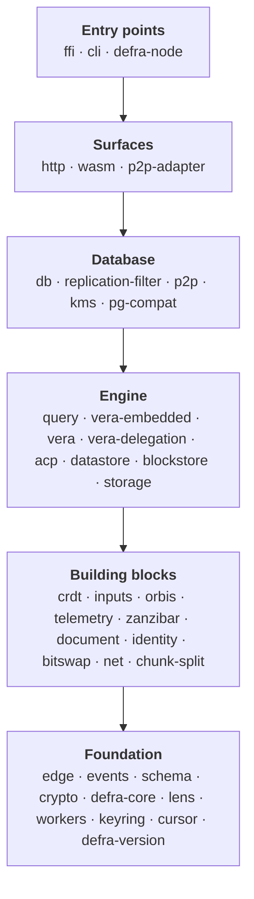

# Crates

DefraDB's crates are organised by **level**. Each level is a folder, and each
crate lives in exactly one of them.

> [!IMPORTANT]
> A crate may only depend on the crates below it in the hierarchy.
>
> Levels are ordered top to bottom, and the crates within a level are listed in
> the same order: a crate may depend on any crate in a lower level, and on the
> crates listed after it in its own level, never on one above it.

## Contents

| Level | Crates |
|-------|--------|
| [Entry points](entry-points/README.md) | [ffi](entry-points/ffi) · [cli](entry-points/cli) · [defra-node](entry-points/defra-node) |
| [Surfaces](surfaces/README.md) | [http](surfaces/http) · [wasm](surfaces/wasm) · [p2p-adapter](surfaces/p2p-adapter) |
| [Database](database/README.md) | [db](database/db) · [replication-filter](database/replication-filter) · [p2p](database/p2p) · [kms](database/kms) · [pg-compat](database/pg-compat) |
| [Engine](engine/README.md) | [query](engine/query) · [vera-embedded](engine/vera-embedded) · [vera](engine/vera) · [vera-delegation](engine/vera-delegation) · [acp](engine/acp) · [datastore](engine/datastore) · [blockstore](engine/blockstore) · [storage](engine/storage) |
| [Building blocks](building-blocks/README.md) | [crdt](building-blocks/crdt) · [inputs](building-blocks/inputs) · [orbis](building-blocks/orbis) · [telemetry](building-blocks/telemetry) · [zanzibar](building-blocks/zanzibar) · [document](building-blocks/document) · [identity](building-blocks/identity) · [bitswap](building-blocks/bitswap) · [net](building-blocks/net) · [chunk-split](building-blocks/chunk-split) |
| [Foundation](foundation/README.md) | [edge](foundation/edge) · [events](foundation/events) · [schema](foundation/schema) · [crypto](foundation/crypto) · [defra-core](foundation/defra-core) · [lens](foundation/lens) · [workers](foundation/workers) · [keyring](foundation/keyring) · [cursor](foundation/cursor) · [defra-version](foundation/defra-version) |

### Find a crate

| Crate | Level |
|-------|-------|
| [acp](engine/acp) | Engine |
| [bitswap](building-blocks/bitswap) | Building blocks |
| [blockstore](engine/blockstore) | Engine |
| [chunk-split](building-blocks/chunk-split) | Building blocks |
| [cli](entry-points/cli) | Entry points |
| [crdt](building-blocks/crdt) | Building blocks |
| [crypto](foundation/crypto) | Foundation |
| [cursor](foundation/cursor) | Foundation |
| [datastore](engine/datastore) | Engine |
| [db](database/db) | Database |
| [defra-core](foundation/defra-core) | Foundation |
| [defra-node](entry-points/defra-node) | Entry points |
| [defra-version](foundation/defra-version) | Foundation |
| [document](building-blocks/document) | Building blocks |
| [edge](foundation/edge) | Foundation |
| [events](foundation/events) | Foundation |
| [ffi](entry-points/ffi) | Entry points |
| [http](surfaces/http) | Surfaces |
| [identity](building-blocks/identity) | Building blocks |
| [inputs](building-blocks/inputs) | Building blocks |
| [keyring](foundation/keyring) | Foundation |
| [kms](database/kms) | Database |
| [lens](foundation/lens) | Foundation |
| [net](building-blocks/net) | Building blocks |
| [orbis](building-blocks/orbis) | Building blocks |
| [p2p](database/p2p) | Database |
| [p2p-adapter](surfaces/p2p-adapter) | Surfaces |
| [pg-compat](database/pg-compat) | Database |
| [query](engine/query) | Engine |
| [replication-filter](database/replication-filter) | Database |
| [schema](foundation/schema) | Foundation |
| [storage](engine/storage) | Engine |
| [telemetry](building-blocks/telemetry) | Building blocks |
| [vera](engine/vera) | Engine |
| [vera-delegation](engine/vera-delegation) | Engine |
| [vera-embedded](engine/vera-embedded) | Engine |
| [wasm](surfaces/wasm) | Surfaces |
| [workers](foundation/workers) | Foundation |
| [zanzibar](building-blocks/zanzibar) | Building blocks |
