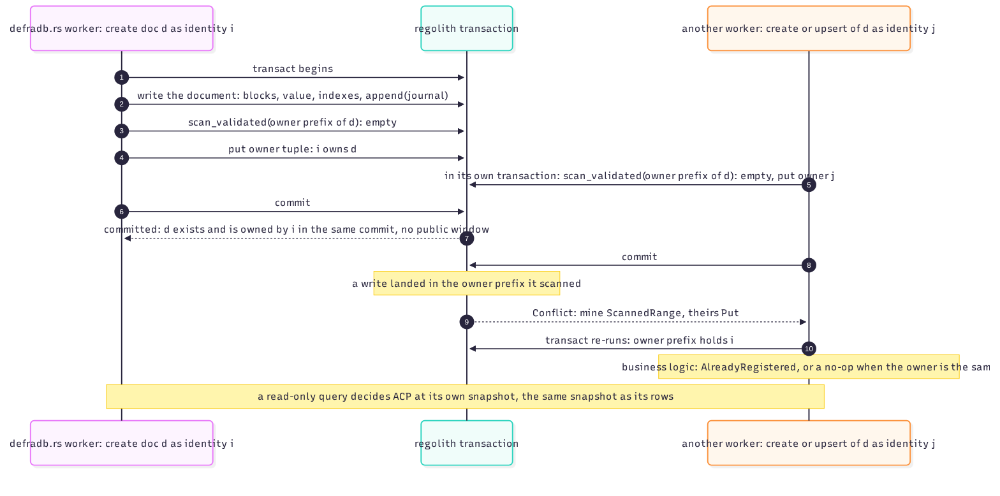

# ACP inside the transaction

The rule that makes local ACP trustworthy: **every access decision runs in the
transaction it authorizes, on the same snapshot as the data it gates**. Not a pre-check,
not a cache consultation before the transaction: inside it, validated exactly like a
data decision. An external provider (Vera) cannot join a local transaction; its shape
is the exception below.

## The create path: no public window

A create writes the document (blocks, value, index entries, journal append) and then,
*in the same transaction*, scans the document's owner prefix with a **validated scan**
and puts the owner tuple. The commit that makes the document visible also makes its
owner tuple visible: there is no commit boundary between them, hence no window where the
document exists unowned and public.

A concurrent upsert/create of the same document by another identity loses that race: its
validated scan of the owner prefix meets the first writer's tuple put
(`mine ScannedRange, theirs Put`), its re-run finds the existing owner, and business
logic answers `AlreadyRegistered` (or a no-op when the owner is identical).

## The read path: one snapshot

A read-only query decides DAC at its own snapshot: the tuples and the document rows come
from the same consistent view. There is no "authorization checked, then data read"
pair of snapshots to disagree.

## The write path: validated tuples

A write's authorization is a decision on tuples, so it uses exactly the read rules for
decisions:

- point reads of the tuples that grant the identity's permission are validated reads;
- decisions over a set (the owner prefix, a claim queue) are validated scans.

A revocation, grant or new registration that commits first aborts the decision, the
attempt re-runs, and the re-run decides again on the fresh tuples. The revocation race
(the [race gallery](../txn/conflict-logic.md) covers it step by step) lands as: the write
never commits after the revocation it raced.

## External providers (Vera) under the same shape

An external decider cannot join a local transaction. The database keeps the shape anyway:
the create writes an *owed registration* record (a pending marker under the ACP
namespace) in its own transaction; until the provider confirms, the document's reads are
gated to its creator alone; a paged redrive settles owed registrations; and during
engine retries, an external decision is asked once, memoized by request bytes, and
replayed identically for later attempts. Failures of the provider fail closed
(`Unavailable` denies).

### Owed relationship changes

The same bridge has a record for a relationship change made inside a transaction
(`acp::outbox`). Nothing stages one yet: the in-transaction relationship call still
refuses on an external provider, so the records below stay empty and every path behaves
as before. What exists is the record and the gate that reads it.

- **The record.** A change is written in the transaction that stages it, under the ACP
  namespace, and commits or rolls back with its rows: `/acp-owed/q/<seq>` holds the
  change (tuple, add or delete, acting DID, the authority to submit it as that DID, its
  state, attempts and last error; at most 16 KiB), `/acp-owed/t/<tuple>` what is
  unsettled on that tuple (its oldest and latest sequences, how many changes and how many
  of them deletes), and `/acp-owed/o/<object>` the number of unsettled changes on that
  object. A change is unsettled while it has a record, a refused one included; a settled
  change has none.
- **The order.** A sequence comes from `Db::allocate` after the staging transaction read
  the tuple's key, which it also writes. Two transactions that stage the same tuple
  conflict, and the one that commits later holds the higher sequence. Across tuples a
  sequence follows the order of staging, not of commit, so a lower sequence can appear
  in the queue after a higher one: a reader of the queue starts from its head each time
  instead of keeping a high-water mark.
- **The bounds.** One transaction stages at most 256 changes and a node holds at most
  10,000 unsettled; either is a typed error before the commit. The node's bound is a
  constant with no configuration key yet, and it is checked against the count the staging
  transaction sees, so transactions staging at once can pass it by what they stage
  together.
- **The gate.** While any delete of a tuple is unsettled, the adapter denies that
  tuple's subject on that object before it asks the provider: on document access, on
  access decisions, and on the authority to add or delete relationships. An add staged
  after the delete does not lift the denial: the provider may refuse that add and apply
  the delete, and until it has seen the delete it still grants what the delete takes. The
  denial covers every permission on the object, so a subject that also holds access by
  another path waits for the settlement. A delete whose subject is wider than one actor
  (the wildcard, a set of another object's holders) denies everyone. The owner, as the
  provider names it, is spared in both cases. The denial starts at the commit, on this
  node: a transaction is not denied by a delete it has staged and not yet committed, and
  other nodes see the revocation once the provider holds it. An owed add grants nothing.
  With nothing owed on an object the gate costs one point read.

## The query engine's side

The planner wraps collection plans in permission filter nodes; `_commits` rows,
mutation target sets and arrival entries are filtered through the same checker; the
block read gate checks ACP before serving replicated blocks. Unregistered documents are
public only when the node's configuration says so.

> **Why validated, not cached.** A cached authorization is an answer about the past
> being reused for the present: between cache fill and use, a revocation may have
> landed, and the write would commit on an authorization that no longer exists.
> Validated tuples make the authorization itself part of the commit's consistency
> guarantee: if anything it rested on changed, the commit loses, exactly like a data
> race. That symmetry is the entire trick, and the TLA+ models for ACP soundness and
> the deferred-ACP overlay pin it.
