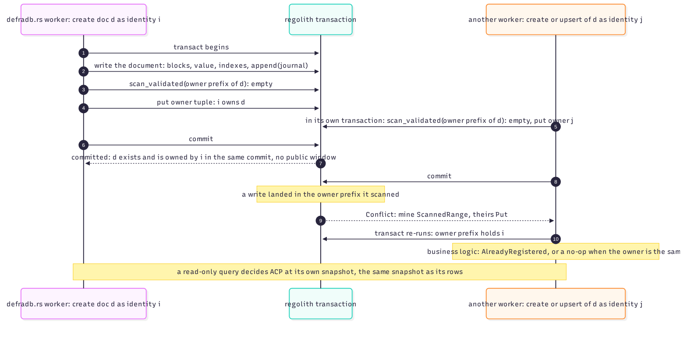

# ACP inside the transaction

The rule that makes local ACP trustworthy: **every access decision runs in the
transaction it authorizes, on the same snapshot as the data it gates**. Not a pre-check,
not a cache consultation before the transaction: inside it, validated exactly like a
data decision. An external provider (Vera) cannot join a local transaction; its shape
is the exception below.

## The create path: no public window

A create writes the document (blocks, value, index entries, journal append) and then,
*in the same transaction*, scans the document's owner prefix with a **validated scan**
and puts the owner tuple. The commit that makes the document visible also makes its
owner tuple visible: there is no commit boundary between them, hence no window where the
document exists unowned and public.

A concurrent upsert/create of the same document by another identity loses that race: its
validated scan of the owner prefix meets the first writer's tuple put
(`mine ScannedRange, theirs Put`), its re-run finds the existing owner, and business
logic answers `AlreadyRegistered` (or a no-op when the owner is identical).

## The read path: one snapshot

A read-only query decides DAC at its own snapshot: the tuples and the document rows come
from the same consistent view. There is no "authorization checked, then data read"
pair of snapshots to disagree.

## The write path: validated tuples

A write's authorization is a decision on tuples, so it uses exactly the read rules for
decisions:

- point reads of the tuples that grant the identity's permission are validated reads;
- decisions over a set (the owner prefix, a claim queue) are validated scans.

A revocation, grant or new registration that commits first aborts the decision, the
attempt re-runs, and the re-run decides again on the fresh tuples. The revocation race
(the [race gallery](../txn/conflict-logic.md) covers it step by step) lands as: the write
never commits after the revocation it raced.

## External providers (Vera) under the same shape

An external decider cannot join a local transaction. The database keeps the shape anyway:
the create writes an *owed registration* record (a pending marker under the ACP
namespace) in its own transaction; until the provider confirms, the document's reads are
gated to its creator alone; a paged redrive settles owed registrations; and during
engine retries, an external decision is asked once, memoized by request bytes, and
replayed identically for later attempts. Failures of the provider fail closed
(`Unavailable` denies).

## The query engine's side

The planner wraps collection plans in permission filter nodes; `_commits` rows,
mutation target sets and arrival entries are filtered through the same checker; the
block read gate checks ACP before serving replicated blocks. Unregistered documents are
public only when the node's configuration says so.

> **Why validated, not cached.** A cached authorization is an answer about the past
> being reused for the present: between cache fill and use, a revocation may have
> landed, and the write would commit on an authorization that no longer exists.
> Validated tuples make the authorization itself part of the commit's consistency
> guarantee: if anything it rested on changed, the commit loses, exactly like a data
> race. That symmetry is the entire trick, and the TLA+ models for ACP soundness and
> the deferred-ACP overlay pin it.
