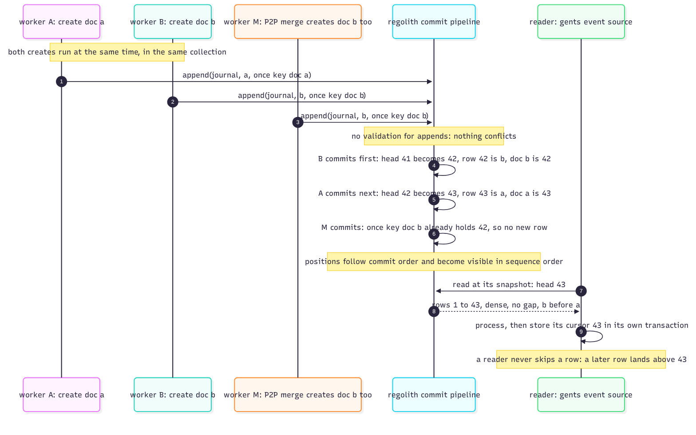

# The arrival journal

The arrival journal answers a deceptively hard question: *in what order did documents
first appear on this node?* Clients that consume events (a search indexer, a projection
builder, an agent) need a durable, gap-free feed of arrivals, and ordinary key layout
cannot give it: documents arrive from local writes and P2P merges on different cores,
and "sorted by DocID" is not an arrival order.



## The mechanism

Each collection has a journal, stored as a **Log** under `s/arrival/`
([`crates/db/src/event/arrivals.rs`](https://github.com/sourcenetwork/defradb.rs/blob/main/crates/db/src/event/arrivals.rs)):

- `/arrival/{collection}/head`: the number of rows,
- `/arrival/{collection}/row/{cursor:020}`: one row per position, holding a DocID,
- `/arrival/{collection}/doc/{doc}`: the once key, the document's cursor.

A create (local or replicated) *appends* to the journal inside its own transaction, with
the document as the once key. The engine assigns positions in commit order: nothing
conflicts, and a document appended twice (a local create racing a P2P merge of the same
document) keeps exactly one row, because the once key is applied exactly once. Position
keys are zero-padded to a fixed width (`{cursor:020}`, `crates/storage/src/backends/
[regolith](https://sourcenetwork.github.io/regolith/)/log_layout.rs`) so they sort in position order; the layout is frozen: a store
keeps reading its journal across releases.

## The dense prefix

A reader at a snapshot sees a **dense prefix**: rows 1..head, no gaps. A later arrival
commits at a position above `head` (positions are assigned in commit order and become
visible in sequence order), so a reader that stored its cursor at 43 will see row 44
next, never a hole at 44 filled in later. The read path enforces it as an invariant, not
a hope: a missing row inside the read range is a hard error ("missing arrival row"),
never silently skipped.

## The API: `_documentArrivals`

The GraphQL system collection exposes the journal:

```graphql
{
  _documentArrivals(collection: "Users", after: 42, limit: 100) {
    head
    next
    entries { cursor docID }
  }
}
```

At the GraphQL surface an omitted `limit` defaults to 256, and a `limit` of zero or
above 1024 is rejected (as is a `docID` list longer than 1024); the lower-level database
read clamps its page to the 1024 ceiling. The result carries `head`,
the next cursor, and ACP-filtered entries (each entry's document is checked before it is
returned). The client consumes a page, processes it, stores its cursor durably, and
continues: the same discipline as a CDC log, minus a server-side session.

> **Why a log the engine assigns instead of a table the database numbers.** Two
> writers on two cores cannot number rows without a serialization point. The engine's
> commit-ordered append *is* the serialization point, but it costs nothing extra: the
> position is assigned in the same ordered step of the commit that makes the document
> visible, so the journal order and the visibility order are the same order, by
> construction. The once key gives exactly-one-row-per-document without a unique index,
> and the dense prefix falls out of positions being visible in sequence order.
