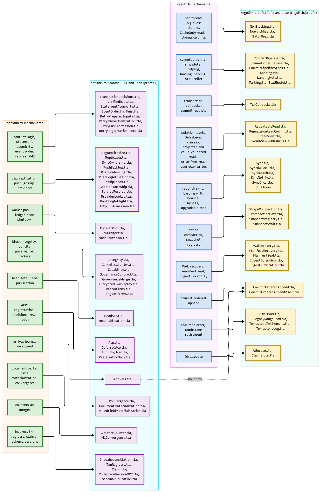

# Verification

defradb.rs carries its correctness argument beside the code, in two tools
([`proofs/README.md`](https://github.com/sourcenetwork/defradb.rs/blob/main/proofs/README.md)):

- **TLA+ / TLC** for temporal, distributed and concurrent behaviour: convergence,
  "eventually merges", safety under adversarial interleavings. 52 models live in
  `proofs/tla/`, each with GREEN configurations and, for every guard, a RED
  configuration that plants a named bug and must fail on its named invariant. Each
  TLC run finishes in under 60 seconds; the whole suite in under 10 minutes.
- **Lean 4** for functional and algebraic properties: CRDT merge laws
  (commutativity, associativity, idempotence, order-independence), encodings and
  round-trips, data structure invariants (`proofs/lean/`). No `sorry`, no `admit`, no
  new axioms.

Some theorems need both halves: **DAG convergence** = (TLA+: every node eventually
receives every delta under eventual connectivity) x (Lean: applying deltas in any
order yields the same state). Neither half alone is convergence.

## The map

Every mechanism, in [regolith](https://sourcenetwork.github.io/regolith/) and in defradb.rs, mapped to the models that cover it,
under the names they ship with in each repo's proofs tree. (This map supersedes the
migration-era sketch: several models were renamed as they landed, and the rows below
were checked against `regolith/proofs/tla/` and this repo's `proofs/tla/`.)

## What is modelled

The coverage map in [`proofs/README.md`](https://github.com/sourcenetwork/defradb.rs/blob/main/proofs/README.md) lists 40 modelled families. Representative
entries, by book chapter:

| Mechanism (chapter) | Model |
|---|---|
| Key classes, validation, conflict rules ([Transactions](../txn/conflict-rules.md)) | [`DefraKeyClassifier.tla`](https://github.com/sourcenetwork/defradb.rs/blob/main/proofs/tla/DefraKeyClassifier.tla), storage transaction validation models |
| Commit-ordered arrivals ([arrival journal](../documents/arrival-journal.md)) | [`Arrivals.tla`](https://github.com/sourcenetwork/defradb.rs/blob/main/proofs/tla/Arrivals.tla) (bound to the engine's commit-ordered append) |
| Head sets ([head sets](../documents/head-sets.md)) | [`HeadSet.tla`](https://github.com/sourcenetwork/defradb.rs/blob/main/proofs/tla/HeadSet.tla), [`HeadPublication.tla`](https://github.com/sourcenetwork/defradb.rs/blob/main/proofs/tla/HeadPublication.tla) |
| CRDT convergence ([CRDTs](../documents/crdt.md)) | [`Convergence.tla`](https://github.com/sourcenetwork/defradb.rs/blob/main/proofs/tla/Convergence.tla) + the Lean merge-law family |
| ACP: soundness, revocation, deferred overlay ([ACP](../acp/transactional.md)) | [`Acp.tla`](https://github.com/sourcenetwork/defradb.rs/blob/main/proofs/tla/Acp.tla), [`DeferredAcp.tla`](https://github.com/sourcenetwork/defradb.rs/blob/main/proofs/tla/DeferredAcp.tla), [`Auth.tla`](https://github.com/sourcenetwork/defradb.rs/blob/main/proofs/tla/Auth.tla) |
| Owner registration exactly once | [`RegisterDocOnce.tla`](https://github.com/sourcenetwork/defradb.rs/blob/main/proofs/tla/RegisterDocOnce.tla) (cross-referenced from [`crates/acp/src/zanzibar/store/persistent.rs`](https://github.com/sourcenetwork/defradb.rs/blob/main/crates/acp/src/zanzibar/store/persistent.rs)) |
| Explicit transactions: statement atomicity, idle sweep ([explicit](../txn/explicit.md)) | statement atomicity + registry models, [`CommitFence.tla`](https://github.com/sourcenetwork/defradb.rs/blob/main/proofs/tla/CommitFence.tla) (with a Lean swap proof) |
| Event order by receipt ([Events](../events/index.md)) | [`EventOrder.tla`](https://github.com/sourcenetwork/defradb.rs/blob/main/proofs/tla/EventOrder.tla) |
| The worker pool ([Threading](../threading/pool.md)) | [`DefaultPool.tla`](https://github.com/sourcenetwork/defradb.rs/blob/main/proofs/tla/DefaultPool.tla), [`CpuLedger.tla`](https://github.com/sourcenetwork/defradb.rs/blob/main/proofs/tla/CpuLedger.tla) (TLA+ and Lean) |
| Lens epoch ticks | lens tick models |
| KMS distribution and replay ([API](../api/index.md)) | [`Kms.tla`](https://github.com/sourcenetwork/defradb.rs/blob/main/proofs/tla/Kms.tla), [`EncryptedLwwReplay.tla`](https://github.com/sourcenetwork/defradb.rs/blob/main/proofs/tla/EncryptedLwwReplay.tla) |
| P2P: replication, providers, admission ([Replication](../p2p/sync.md)) | DAG convergence, replicator lifecycle, sync ownership, gossip, service-record and reply-driven-fetch families |
| JWT issuer binding | [`Jwt.tla`](https://github.com/sourcenetwork/defradb.rs/blob/main/proofs/tla/Jwt.tla) |
| Index maintenance, unique resolution ([Indexes](../query/indexes.md)) | index reconciliation + unique resolution models |

## The rules of engagement

- **The model ships with the change**, and before the code: a spec is the contract;
  a model that does not pass means the design is broken, and the code waits.
- A model names the Rust code it models (file and function) and is wired into the
  proof runner's registry; a model that no longer matches the code is a defect.
- Proof files read ELI5: every line of spec carries a plain-words comment, every
  invariant opens with a one-sentence statement of its promise, every RED config says
  which bug it plants.

## The honest gaps

The coverage map also records the backlog: engine OCC is an implementation boundary;
[`HeadSet.tla`](https://github.com/sourcenetwork/defradb.rs/blob/main/proofs/tla/HeadSet.tla) models derived head keys and scan/write conflicts, not
collection-version validation; remote ACP/Vera check paths, dynamic KMS policy
changes, and cold read-time decryption remain audit gaps. The inventory says so in
the same table as the coverage, because a proof map that hides its holes is a
falsified map.

> **Why models at all, for a database.** The properties that matter here - convergence
> under reordering, no public ACP window, exactly-once registration, dense arrival
> prefixes, no lost commit after a fence - are exactly the class testing cannot
> establish: a test shows one interleaving is fine; a model checker shows all of them
> are, within each model's configured bounds and assumptions (small bounded instances,
assumed connectivity and fairness; a green run is not an unbounded deployment
guarantee). And the RED configurations are the part that keeps the greens honest: a guard
> that cannot be broken on purpose is a guard nobody understands.
