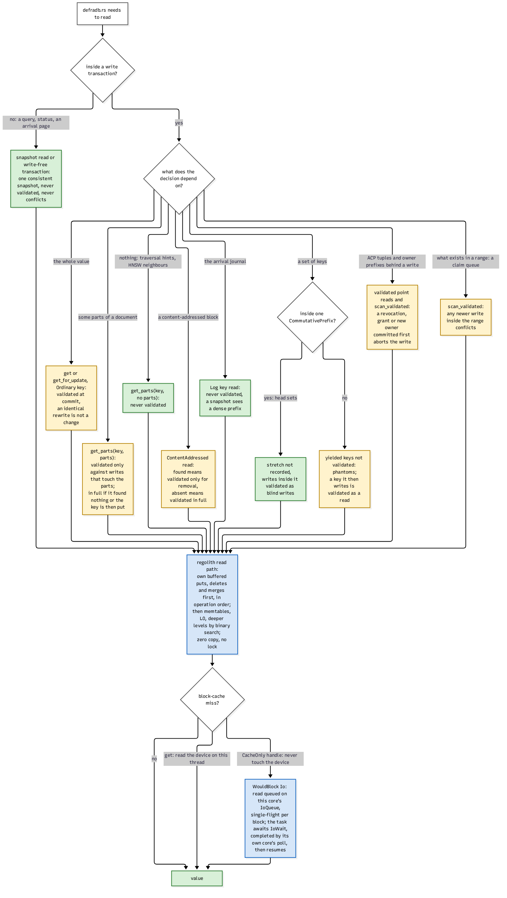

# Read scenarios

For every kind of read in defradb.rs, this page answers two questions: what (if anything)
is validated at commit, and where does the value come from.

## The decision table

**Reads outside write transactions never conflict.** A query, a status read, an arrival
page: one consistent snapshot, never validated, never conflicting. Read-only transactions
do not even begin an engine transaction; they pin a snapshot.

**Inside one, the class of the key and the call decide the validation:**

- An **Ordinary key** (`get`, `get_for_update`): validated in full. An identical rewrite
  is not a change, so re-writing what you read does not conflict.
- A **projected read** (`get_parts(key, parts)`): validated only against writes that
  touch those parts; in full if the read found nothing (absence is a decision about the
  whole value) or if the transaction then writes the key.
- An **unvalidated read** (`get_parts(key, &[])`): never validated. Traversal hints,
  HNSW neighbours, head sets: reads whose result decides nothing that a later write of
  the key would invalidate.
- A **ContentAddressed key** that was found: validated only for removal (the block you
  based a decision on must not have been collected).
- A **Log key** (the arrival journal): never validated; a snapshot sees a dense prefix.
- A **scan inside a commutative prefix**: the stretch is not recorded; writes inside it
  are blind.
- A **plain scan**: yielded keys are not validated (phantoms do not matter to a snapshot
  read); a key the transaction then writes is validated as a read of that key.
- **ACP tuples and owner prefixes behind a write**: validated point reads and
  `scan_validated`, so a revocation, grant or new owner committed first aborts the write.
- **A decision on what exists in a range** (a claim queue): `scan_validated`; any newer
  write inside the range conflicts.

The same table, as code policy, lives in the repository's working agreement, and the
mechanisms are exercised end to end in `crates/storage/src/backends/regolith/` and the
collection read paths ([`crates/db/src/collection/crud.rs`](https://github.com/sourcenetwork/defradb.rs/blob/main/crates/db/src/collection/crud.rs)).

## Where the value comes from

The engine's read path serves a read with: the transaction's own buffered puts, deletes
and merges first, in operation order; then the memtables, then L0, then deeper levels by
binary search. Zero copy, no lock.

A block-cache miss is the interesting case:

- A `get` on the calling thread reads the device there.
- A `CacheOnly` handle never touches the device: the miss becomes a `WouldBlock` carry
  an `IoWait`, the read is queued on this core's own `IoQueue`, single-flight per block,
  the task awaits, and its own core's poll completes it and resumes the task
  ([the worker pool](../threading/pool.md) has the threading).

> **Why CacheOnly on workers.** A blocking read on a data-path core would stall every
> task on that core behind one device latency. CacheOnly turns the miss into exactly the
> same suspension as any other await: the core runs other tasks, the completion arrives
> on the core's own queue, and the task resumes where it left off. Single-flight per
> block means N tasks awaiting the same block cost one device read.
