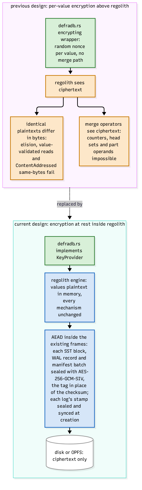

# Encryption at rest

defradb.rs encrypts storage in two distinct places, and the difference matters:

1. **Document field encryption** (application-level, Go-compatible): individual field
   values are sealed with fresh AES-256 keys delivered by the KMS; the encrypted payload
   becomes part of the block's CID. Covered with the [KMS](../api/index.md) and
   [blocks](../documents/blocks.md).
2. **Encryption at rest** (engine-level): when at-rest keys are configured, [regolith](https://sourcenetwork.github.io/regolith/)
   seals every file it writes, so a stolen data directory is ciphertext. Without
   configured keys the engine does not seal anything. This chapter.

## What the engine seals

Every SST block, WAL record and manifest batch is sealed inside its existing frame with
AES-256-GCM-SIV, the tag taking the place of the checksum ([`regolith/src/engine/seal.rs`](https://github.com/sourcenetwork/regolith/blob/main/src/engine/seal.rs)).
Values are **plaintext inside the engine**: byte equality, value-validated reads,
ContentAddressed same-bytes checks and merge operators all keep their meaning, because
nothing above the file layer ever sees ciphertext. With keys configured, disk (or OPFS)
holds ciphertext only; without them, files are plaintext.

This is precisely why encryption lives *below* the mechanisms rather than above them. The
diagram's upper half records the previous design, a per-value encrypting wrapper above the
engine: with a random nonce per value, identical plaintexts differ in bytes, so elision,
value-validated reads and content-addressed block identity all broke, and merge operators
saw ciphertext, making counters and head sets impossible. That wrapper was deleted, and a
one-time rewrite migrates old stores at open
(`crates/storage/src/backends/regolith/rewrite/`).

## Where keys come from

defradb.rs implements regolith's `KeyProvider`
([`crates/storage/src/backends/regolith/encryption.rs`](https://github.com/sourcenetwork/defradb.rs/blob/main/crates/storage/src/backends/regolith/encryption.rs)):

- `current()` returns the active key id: the first 4 bytes of a domain-separated SHA-256
  of the key material.
- `key(id)` returns the key bytes for an id, so old files remain readable after rotation.

`AtRestKeys::single(key)` seals everything with one key; `rotated(current, older)`
supports rotation with a set of older keys (refusing two distinct keys that share an id,
with a birthday-search test proving the check). Compaction re-seals files it rewrites
under the current key, so rotation completes as data churns.

Keys enter through the node builders (`with_at_rest_encryption_key`,
`with_previous_at_rest_encryption_keys` on both the `defra-node` and `embedded`
builders), and the CLI fetches them from the keyring (`crates/keyring`: file (JWE),
OS keyring, or systemd-creds backends; standard names `encryption-key` and
`encryption-key-previous`).

## What is deliberately not encrypted at rest

The engine seals file contents, not file *metadata*: the shape of the LSM (file count,
sizes, write pattern) remains visible to someone who holds the directory. Field-level
encryption is the answer when the *existence* of a value must be hidden: an encrypted
field's block CID is derived from ciphertext, so the database cannot read it without the
KMS, independent of at-rest encryption.

> **Why AEAD inside the frame.** Sealing inside the existing SST/WAL frames means
> encryption is not a new format: recovery, checksums, tooling and proofs are about the
> same frame with a tag where the checksum was. GCM-SIV specifically (misuse-resistant
> AEAD) means a repeated nonce under any bug does not leak both plaintexts wholesale,
> which is the failure mode you cannot rule out in a long-lived storage engine.
