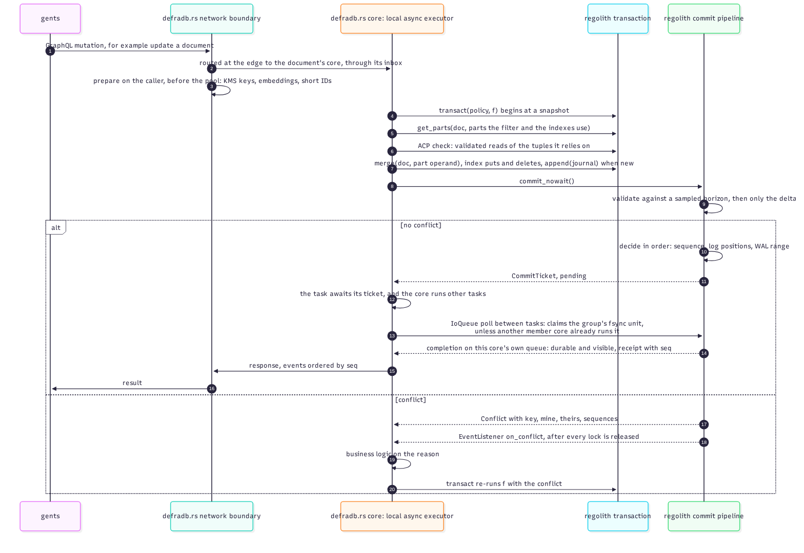

# A request, end to end

This chapter traces one GraphQL mutation, an update of a single document, from the client
to durable, visible state and back. It is a preview of every mechanism in the book; each
step links to the chapter that covers it in depth.

The numbered steps below follow the diagram.

## 1. In, and routed at the edge

The client sends the mutation over HTTP (or the embedded call path). The network edge, the
one tokio runtime, parses only what routing needs: which document (if exactly one) a
mutation names. Everything else about the query is parsed and planned on a worker of
the pool, routed once, here, at the edge. A mutation naming exactly one document goes to that
document's core, so its writes and merges run one at a time; everything else goes to the
least-loaded core
([`crates/query/src/pooled/route.rs`](https://github.com/sourcenetwork/defradb.rs/blob/main/crates/query/src/pooled/route.rs), [`crates/workers/src/pool/routing.rs`](https://github.com/sourcenetwork/defradb.rs/blob/main/crates/workers/src/pool/routing.rs)). No request
hops from core to core.

## 2. Prepare outside effects

Before any database worker is involved, the caller (the edge task) prepares everything
with an effect outside the transaction: KMS keys, embeddings, signatures, short IDs.
Only then is the prepared work submitted to the pool
([`crates/query/src/runner/prepare.rs`](https://github.com/sourcenetwork/defradb.rs/blob/main/crates/query/src/runner/prepare.rs)). A transaction closure may run more than once, so
anything with an outside effect must already be in hand. Remote inputs that depend on the
transaction's own reads end the attempt, get resolved at the edge (single-flight, batched,
cached), and the attempt re-runs with them memoized.

## 3. The transaction

`transact` begins at a snapshot and runs the closure. Inside, the worker:

- reads only the parts it decides on: `get_parts(doc, parts the filter and the indexes
  use)`, a projected read validated against writes to exactly those parts
  ([Reads](../reads/scenarios.md));
- checks ACP with validated reads of the tuples the decision relies on
  ([ACP inside the transaction](../acp/transactional.md));
- writes field operands as blind merges, index entries as blind puts and deletes, and,
  when the document is new, appends to the arrival journal with the document as its once
  key ([Writes](../writes/scenarios.md)).

## 4. Commit

`commit_nowait` validates against a sampled horizon, then checks only the delta under the
critical section, and returns a ticket. The task awaits it *while its core runs other
tasks*: a commit group's fsync is a claimable unit on every member's `IoQueue`, run by the
first member core to poll it. The completion arrives on this core's own queue: durable and
visible, with a receipt carrying the commit sequence
([The commit path](../txn/commit.md)).

## 5. The conflict branch

When the commit loses a race, [regolith](https://sourcenetwork.github.io/regolith/) returns a `Conflict` with the key, both writes, and
their sequences; the event listener records telemetry; and `transact` re-runs the closure
with the reason. Business logic decides what the reason means: re-decide on fresh data,
report the lost race to the client, or turn it into a no-op
([Conflict business logic](../txn/conflict-logic.md)).

## 6. Out

On success, the response returns to the edge, and events are published in commit-receipt
order (`CommitReceipt.seq`), so subscribers see writes in the order the engine made them
durable ([Events](../events/index.md)).

> **Why this shape.** Every wait in the path is an `.await` on something the worker's own
> core completes: the commit ticket, an I/O wait, an input event. The core is never
> blocked, never idles when it has runnable tasks, and is never woken when busy. That is
> the threading contract in one request.
