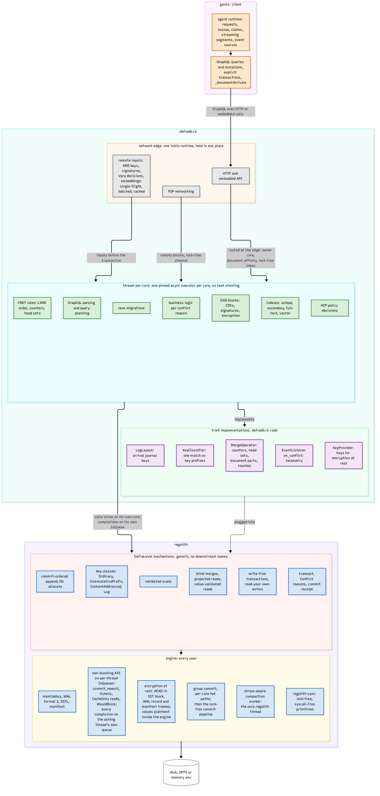

# Who owns what

defradb.rs is a layered system with exactly one rule of ownership per layer. The diagram
below is the whole story; the rest of this book walks each box. (The participant labelled
*gents* is the reference client workload; read it as "the client".)

## The layers

**The client** talks to defradb.rs over GraphQL, either over HTTP or through the embedded
API. It owns its own agent logic: leases, claims, streaming segments, event consumption.

**The network edge** is one tokio runtime, held in one place (`crates/edge`). It terminates
HTTP, P2P, the KMS transport, the Orbis, Vera and embeddings clients, and telemetry export.
It is the only place in the process where a tokio runtime exists; no data-path crate depends
on tokio. The edge also resolves *remote inputs*: KMS keys, signatures, Vera decisions,
embeddings. These are fetched before the transaction that needs them, with single-flight
deduplication, batching and caching, because nothing remote may run inside a transaction
closure that can re-run.

**The thread-per-core pool** is where every database decision runs (`crates/workers`). Each
core runs one pinned executor with no task stealing; a task spawned with `spawn_local`
lives and dies on its core. The pool owns query planning, DAG block construction, CRDT
rules, index maintenance, ACP decisions, lens migrations, and the business logic that
answers each conflict reason.

**The trait implementations** are defradb.rs code that plugs into [regolith](https://sourcenetwork.github.io/regolith/)'s generic
mechanisms: the key classifier (one match on key prefixes), the merge operator (counters,
head sets, document part operands, and their `touches`), the arrival journal's log layout,
the conflict event listener, and the key provider for encryption at rest. regolith's
mechanisms carry no downstream names; they are generic over exactly these traits. In the
code the installed set is slightly larger than the diagram: a `PrefixExtractor`
([`crates/storage/src/backends/regolith/prefix.rs`](https://github.com/sourcenetwork/defradb.rs/blob/main/crates/storage/src/backends/regolith/prefix.rs)) for prefix bloom filters, and
`TransactionHooks` for per-transaction telemetry.

**regolith's DefraLevel mechanisms** are the transactional vocabulary: key classes, blind
merges, projected reads, validated scans, commit-ordered append, `Db::allocate`, write-free
transactions, `transact` with typed conflict reasons, and the commit receipt. Everything
with the word "transaction" in it lives here, not in defradb.rs.

**regolith's engine** serves every user of regolith, not just defradb.rs: memtables, the
WAL, SSTs and the manifest, the compaction worker (the only threads regolith starts; defra's
pool places and classifies them), lock-free `regolith::sync` primitives, and encryption at
rest that seals every SST block, WAL record and manifest batch with an AEAD while values
stay plaintext inside the engine.

**The device** is whatever `regolith::env` provides: real disks, OPFS in the browser, or an
in-memory environment for tests.

## The boundary, in one sentence

defradb.rs owns *what* each operation means; regolith owns *how* transactions stay correct.
Every coordination problem (validation, conflicts, retries, ordering, allocation,
durability) is a regolith mechanism; defradb.rs never adds a lock, a retry loop, or a guard
around storage. That boundary is the load-bearing wall of the architecture, and the next
chapter is about it.
