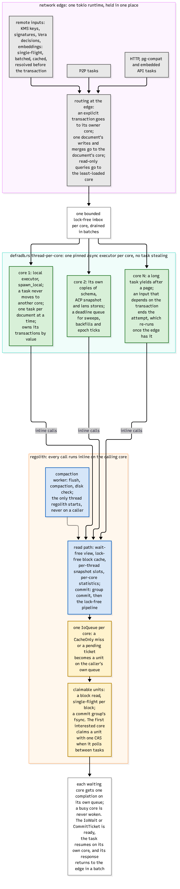

# The worker pool

The pool (`crates/workers`) is the compute side of defradb.rs: one pinned worker per
core, each with its own local executor.

## Workers

Each worker is a pinned thread (the pool's placement spreads workers across NUMA nodes
and L3 domains; spare cores become the background set for the edge, compaction and
blocking threads) running a round:

1. drain its inbox in batches,
2. poll ready tasks (under `catch_unwind`, with heartbeats),
3. poll its hook, which is the [regolith](https://sourcenetwork.github.io/regolith/) `IoQueue` machinery,
4. fire timers from its deadline queue (periodic jobs, the idle sweep).

Tasks are spawned with `spawn_local` and never migrate: a waker from any thread puts
the task back on *its* worker's run queue. Data-path futures need not be `Send`.

## Routing at the edge

The target is chosen once, at the edge ([`crates/workers/src/pool/routing.rs`](https://github.com/sourcenetwork/defradb.rs/blob/main/crates/workers/src/pool/routing.rs)):

- **`Target::Worker(n)`**: an explicit transaction's owner. A transaction is begun on a
  worker and stays there for its whole life; its ID names the worker, so every request
  for it goes straight to that worker, one hop in, one out.
- **`Target::Key(hash)`**: document affinity. The hash picks one worker, which runs
  *one keyed task per key at a time*, the rest waiting in arrival order, so two keyed
  tasks on that worker never interleave at an await. The guarantee is per worker,
  not absolute: GraphQL and REST hash the collection by its name while a P2P merge
  hashes it by its ID, so a local write and a merge of one document may run on
  different workers, and while a home worker is stuck its keyed jobs move to a
  fallback on the same node. Correctness never depends on the affinity; the engine
  validates every commit wherever it runs. The GraphQL router sends a mutation naming
  exactly one document here
  ([`crates/query/src/pooled/route.rs`](https://github.com/sourcenetwork/defradb.rs/blob/main/crates/query/src/pooled/route.rs)); P2P merges use the same affinity
  ([`crates/db/src/merge/pooled.rs`](https://github.com/sourcenetwork/defradb.rs/blob/main/crates/db/src/merge/pooled.rs)).
- **`Target::LeastLoaded`**: everything else (read-only queries, batch work), a
  power-of-two choice among the caller's node.

No request hops worker to worker. Correctness never depends on placement: regolith
validates every commit wherever it runs. Affinity is a performance and contention
property, not a safety one.

## Inboxes

Each worker has a bounded inbox (bounded by items *and* bytes); cross-thread submission
is batched so a batch crosses to each worker once. A monitor detects stuck workers and
moves movable queued jobs. Blocking work (and pinned off-worker code) goes to separate
background/blocking pools, never onto a data-path worker.

## The I/O queues

Each worker holds one regolith `IoQueue` per database, opened lazily on its own thread
the first time a transaction reaches that database
(`crates/storage/src/backends/regolith/worker_io/`). A transaction on a worker reads
`CacheOnly` on that queue (a miss suspends the task on an `IoWait`, never the thread on
the device) and commits with `commit_nowait`, whose ticket the same queue completes.

Between tasks, the worker polls its queues with a budget: completions run regolith
callbacks (which may re-enter), progress folds into the round, and when the worker runs
out of ready work it hands its waker to every queue and parks. A busy core is never
woken; a resting one is woken by the first completion. Single-flight per block means
one device read serves every waiter for that block.

Callers *off* the pool (tests, one-shot tools) still get correct behaviour: the store
borrows an idle queue, drives its own polling inline in the calling task
([`crates/storage/src/backends/regolith/worker_io/drive.rs`](https://github.com/sourcenetwork/defradb.rs/blob/main/crates/storage/src/backends/regolith/worker_io/drive.rs): poll the future; if pending, poll the queue; completions loop,
otherwise park the task on the queue's idle waker), or falls back to blocking reads and
a synchronous commit. Off-pool calls are counted (`off_pool_calls`) so a request that
was not routed is visible in telemetry.

## Remote inputs

KMS keys, signatures, Vera decisions and embeddings are resolved *before* the
transaction, at the edge: single-flight per request key, batched, cached, deadlined,
bounded. A P2P merge is admitted only once its blocks and keys are local. This is why
workers never block on the network: by the time work reaches them, nothing remote is
missing.

> **Why keyed tasks, not keyed locks.** The obvious design is a per-document mutex; the
> pool's is a per-key FIFO inside the executor. Same ordering guarantee, but the
> waiting "holders" are queued tasks, not parked threads: the core keeps running other
> documents' work while one document's turn passes, and no lock object exists to be
> held across an await by mistake.
