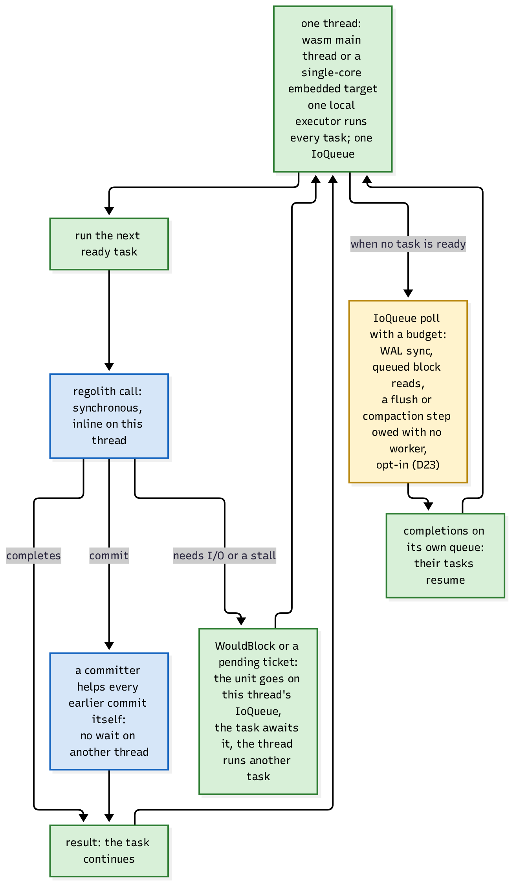

# One thread: wasm and single-core

The same code runs on one thread: the wasm main thread in the browser, or a
single-core embedded target. This is not a degraded fallback; it is the same
architecture with N = 1, and keeping it working is a design constraint that keeps the
whole system honest.

## The loop

One thread, one local executor running every task, one `IoQueue`:

- A [regolith](https://sourcenetwork.github.io/regolith/) call runs synchronous and inline on this thread.
- A call that completes, completes; the task continues.
- A commit helps every earlier commit itself: with one committer there is no other
  thread to wait for, so the committer drives the commit pipeline's steps for the
  slots ahead of its own (the same helping protocol the multi-core path uses, just
  with one helper).
- A call that needs I/O or stalls leaves a unit on this thread's own `IoQueue`; the
  task awaits it; the thread runs another task.
- When no task is ready, the thread polls its own queue with a budget: the WAL sync,
  queued block reads, and (in memory-env configurations with no worker) a flush or
  compaction step owed. Completions wake their tasks.

On wasm the pool runs "driven": one worker on the caller's thread, scheduled by the
browser's event loop; storage mounts OPFS, with durability falling back to eventual
mode when the browser reports no durable sync.

## Why this matters beyond wasm

The single-threaded path is the proof that nothing in the data path secretly requires
a second thread: no `Send` bound, no blocking fallback, no "works with 16 cores"
shortcut. Anything that would block the one thread (a blocking read, a lock on the
data path, a spin) is visible here immediately, which is exactly why the discipline
holds everywhere else.

> **Why one worker is a feature.** An embedded target (a mobile app's local store, an
> edge device) gets the full database: transactions, merges, ACP, replication over the
> same edge, on one core, because the design never bought throughput with a thread
> count.
