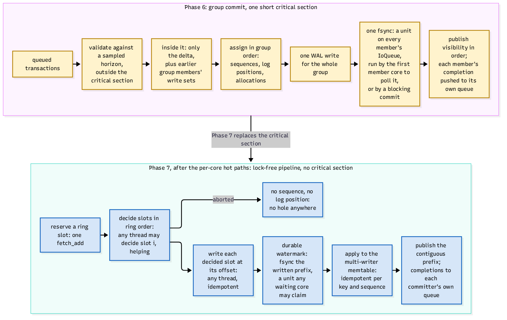

# The commit path

Two properties define defradb.rs commits: **a commit group shares one fsync**, and **a
committing core never blocks the whole core waiting for it**. The engine achieves both
with a two-stage design that defradb.rs taps into without adding anything in between.

## Stage one: group commit

Transactions that arrive together commit together:

1. **Validate against a sampled horizon, outside the critical section.** Each committer
   checks its read set against a recently sampled view of committed sequences; only what
   the sample cannot answer is left for the critical section.
2. **Inside the critical section: only the delta**, plus the write sets of earlier group
   members, so a transaction cannot conflict with a member already decided in the same
   group.
3. **Assign in group order**: commit sequences, log positions (for appends), and ID
   allocations.
4. **One WAL write for the whole group.**
5. **One fsync**, as a claimable unit on every member's `IoQueue`: the first member core
   that polls between tasks claims the unit with one CAS and runs it; a member that would
   block instead (a pool-less caller) runs it as a blocking commit.
6. **Publish visibility in order**; each member's completion is pushed to its own queue.

The critical section is deliberately tiny: everything expensive (validation against old
data, the WAL encoding) happens outside it or once per group.

## Stage two: the lock-free pipeline

Past the group stage, the engine's hot path has no critical section at all. A committer:

- **reserves a ring slot** with one `fetch_add`;
- finds slots **decided in ring order by any thread, through helping**: whichever thread
  reaches an undecided slot decides it, idempotently;
- **writes** the decided slot at its offset (any thread, idempotent per key and
  sequence);
- advances the **durable watermark** by fsyncing the written prefix (a unit any waiting
  core may claim);
- **applies** to the multi-writer memtable and **publishes** the contiguous prefix,
  pushing each committer's completion to its own queue.

An aborted slot leaves no hole: no sequence, no log position, nothing published. A
committer helps every commit ahead of its own and never waits for another thread to be
scheduled; that is the meaning of "helping", and it is what makes the pipeline
lock-free rather than merely fine-grained-locked.

## What defradb.rs adds: nothing in between

The store's module doc states the rule: snapshot capture and native commit use the
engine directly, "so independent commits can join its commit groups"
([`crates/storage/src/backends/regolith/store.rs`](https://github.com/sourcenetwork/defradb.rs/blob/main/crates/storage/src/backends/regolith/store.rs)). On a worker's `IoQueue` the commit is
`commit_nowait` and the ticket is completed by that same queue
([`crates/storage/src/backends/regolith/transaction.rs`](https://github.com/sourcenetwork/defradb.rs/blob/main/crates/storage/src/backends/regolith/transaction.rs)); without a queue, the commit
syncs on the calling thread. Nothing defradb.rs does stands between the caller and the
engine's grouping.

## Ordering on top: the commit receipt

Every commit returns a receipt with a sequence (`CommitReceipt.seq`). defradb.rs uses it
as the one ordering token for everything downstream: post-commit callbacks run in receipt
order across threads ([`crates/storage/src/backends/regolith/event_order.rs`](https://github.com/sourcenetwork/defradb.rs/blob/main/crates/storage/src/backends/regolith/event_order.rs)), and events
are published in that order (see [Events](../events/index.md)). A `seq` is never
persisted across a wipe or restore, so ordering promises never span a database
replacement.

> **Why one fsync per group.** The fsync is the durable, irreducible cost of a commit;
   sharing it across the group is throughput that costs nothing. Making the fsync a
   *claimable unit* on the members' own queues is what keeps it off the critical path of
   any one core: whoever gets to polling first runs it, everyone else's completion
   arrives like any other I/O, and a busy core is never woken to do someone else's
   fsync.
