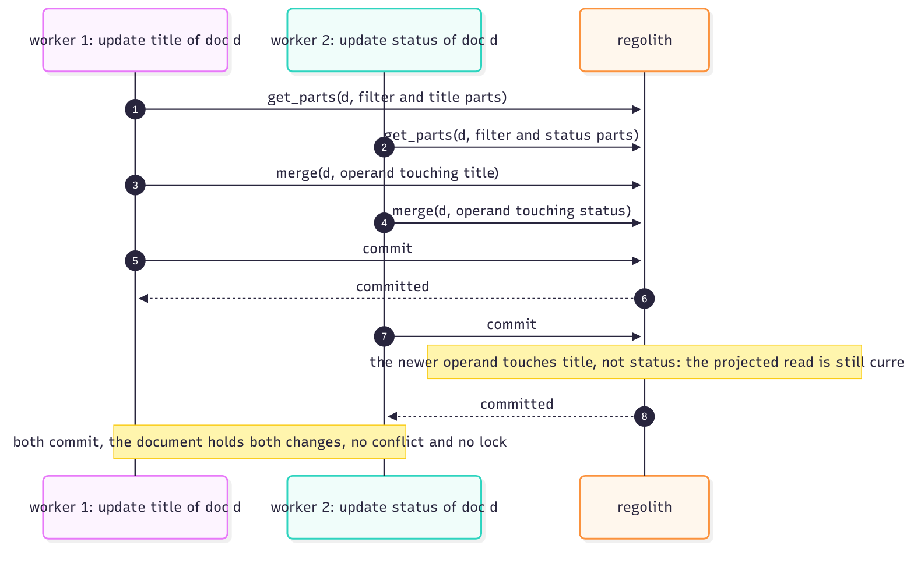
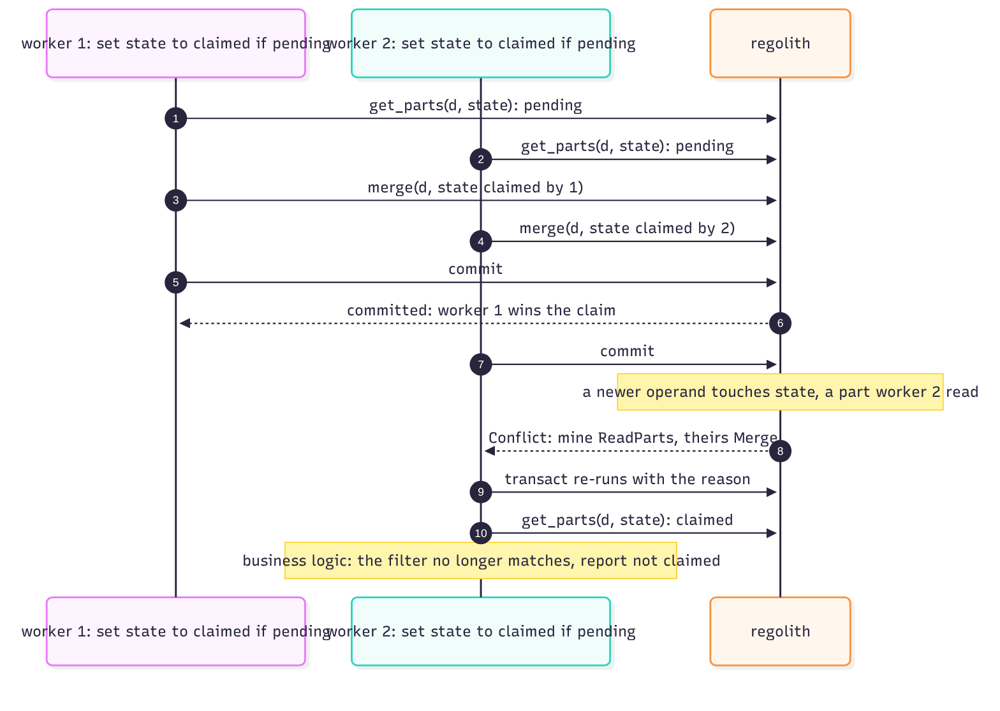
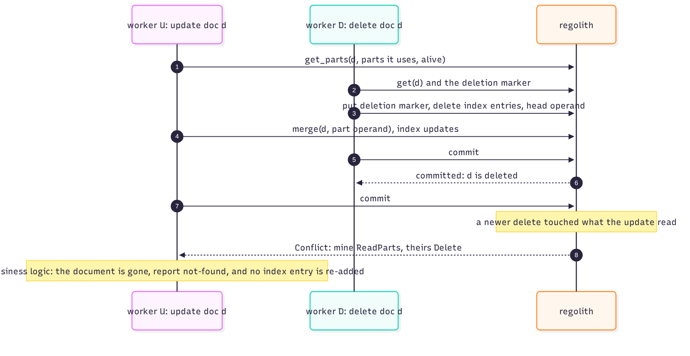
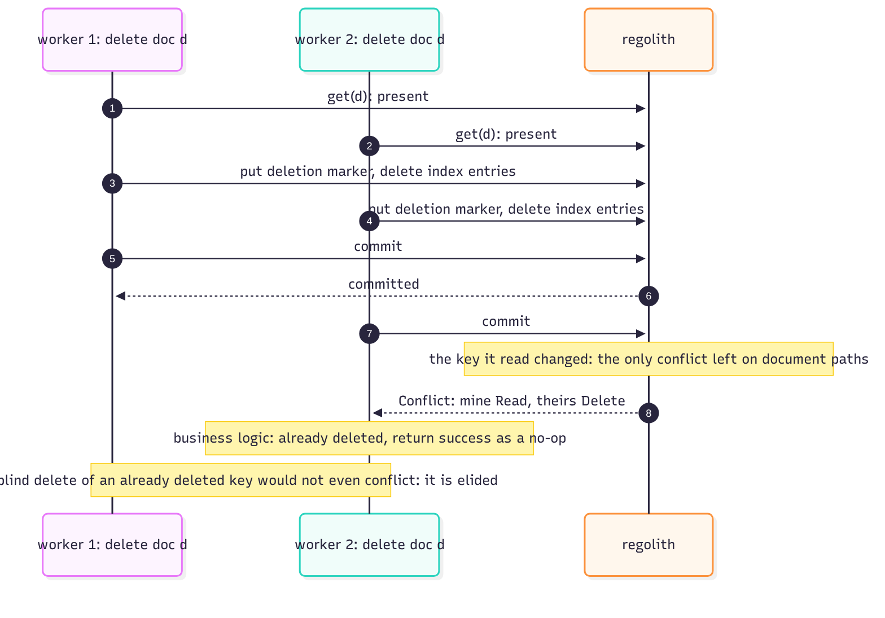
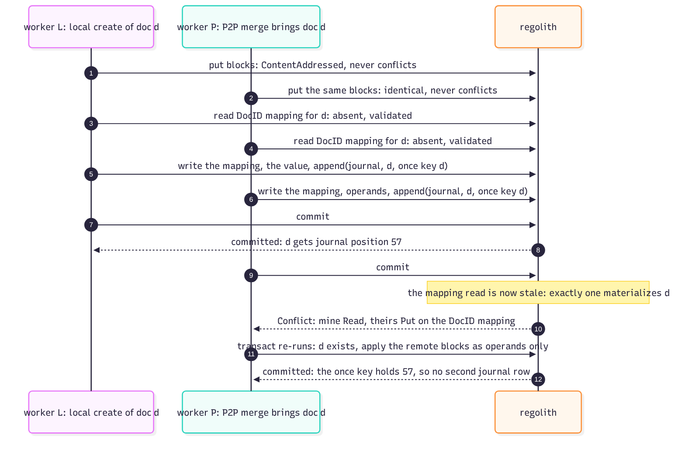
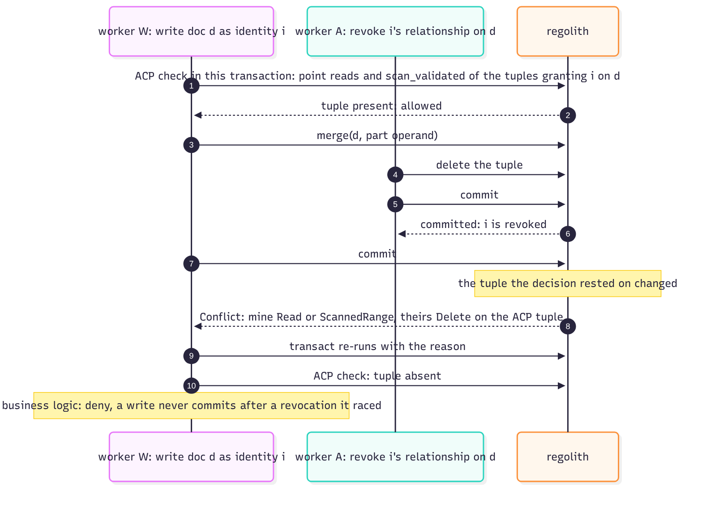
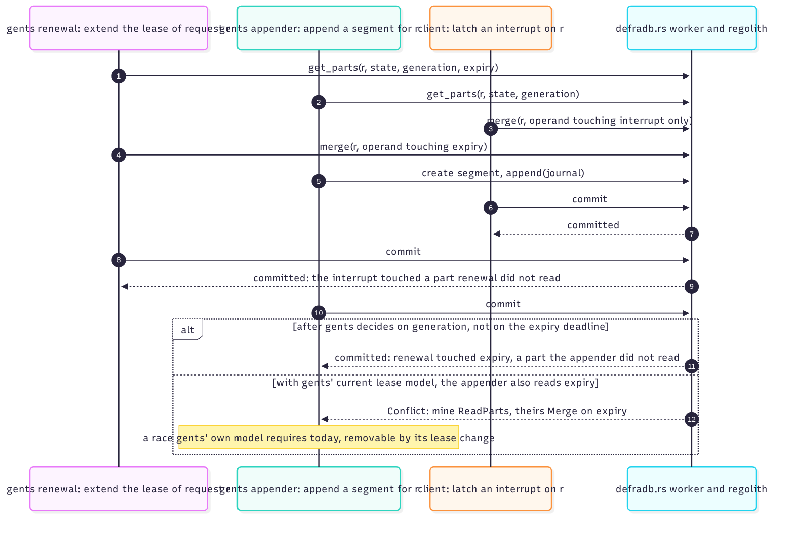

# Conflict business logic

The engine says *who won*; defradb.rs decides *what it means*. This chapter is the race
gallery: each race that can actually occur, and its outcome. Together they are the
regression suite for the conflict design: every one of these has a test that pins it.

## Two updates of different parts

Both commit. Each worker projected-read its own parts and merged an operand touching its
own parts; the operands commute. The document holds both changes, with no lock and no
conflict. This is the common case for concurrent work on one document.

## Two updates of the same part (a claim)

One wins; the loser's projected read meets the winner's operand
(`mine ReadParts, theirs Merge`), and its re-run sees `claimed`, the filter no longer
matches, and the business logic reports "not claimed" to the client. The claim is exactly
a compare-and-set expressed as a projected read plus a merge, so it needs no unique key
and no lock.

## An update against a delete

The delete wins. The update's projected read (which included the `alive` part) meets the
delete; the re-run finds the deletion marker and reports not-found, re-adding no index
entry. Note what did *not* happen: the update did not resurrect the document, because
its decision to write at all was anchored on a validated read.

## A delete against a delete

The second reports "already deleted" as a success no-op. This is the only conflict that
remains on plain document paths, and it exists because each delete read the document as
present; the blind-delete fallback is elided by the engine.

## A local create against a P2P merge of the same document

Both sides put identical blocks (content-addressed, no conflict) and both read the DocID
mapping as absent (validated). One materializes the document; the loser's re-run finds
the mapping present and applies its blocks as operands only. The arrival journal's once
key (the document) holds one row: the loser's append finds the once key already applied,
so the journal has no duplicate even though both attempted an append.

## A write against an ACP revocation

The revocation committed first, so the write's ACP check (validated point reads and a
validated scan of the tuples it relied on) loses its race. The re-run finds the tuple
absent and denies. **No write ever commits after a revocation it raced**: the revocation
is just a delete of an Ordinary key inside the validated range of the write's
authorization decision. The full ACP story is its [own chapter](../acp/transactional.md).

## A client lease, in full

The gents workload keeps per-request state as a document: renewal extends `expiry`, the
appender reads `state` and `generation`, a client latches an `interrupt` operand. The
interrupt commutes with renewal (disjoint parts, both commit). The appender's race with
renewal is the interesting one: under a lease model where the appender also reads
`expiry`, renewal's operand touches a part the appender read, and the appender conflicts;
once gents decides on `generation` instead of the expiry deadline, the parts separate and
the conflict disappears. This race is documented as *the client's own model requiring
it*, removable by the client's lease change, and it is the template for how part design
moves conflicts around: what conflicts is what the two sides' parts share.

## The pattern behind all seven

Every race has the same anatomy:

1. Someone *decided*, so they read with exactly the validation their decision needs.
2. Someone else's write changed what the decision rested on.
3. The engine reports a typed reason; the loser re-runs with it.
4. The business logic reads the reason and produces the domain answer: no-op, not-found,
   not-claimed, denied, or reported to the client.

No locks were taken in any of them. The "lock" is the validated read; the "unlock" is the
commit.
