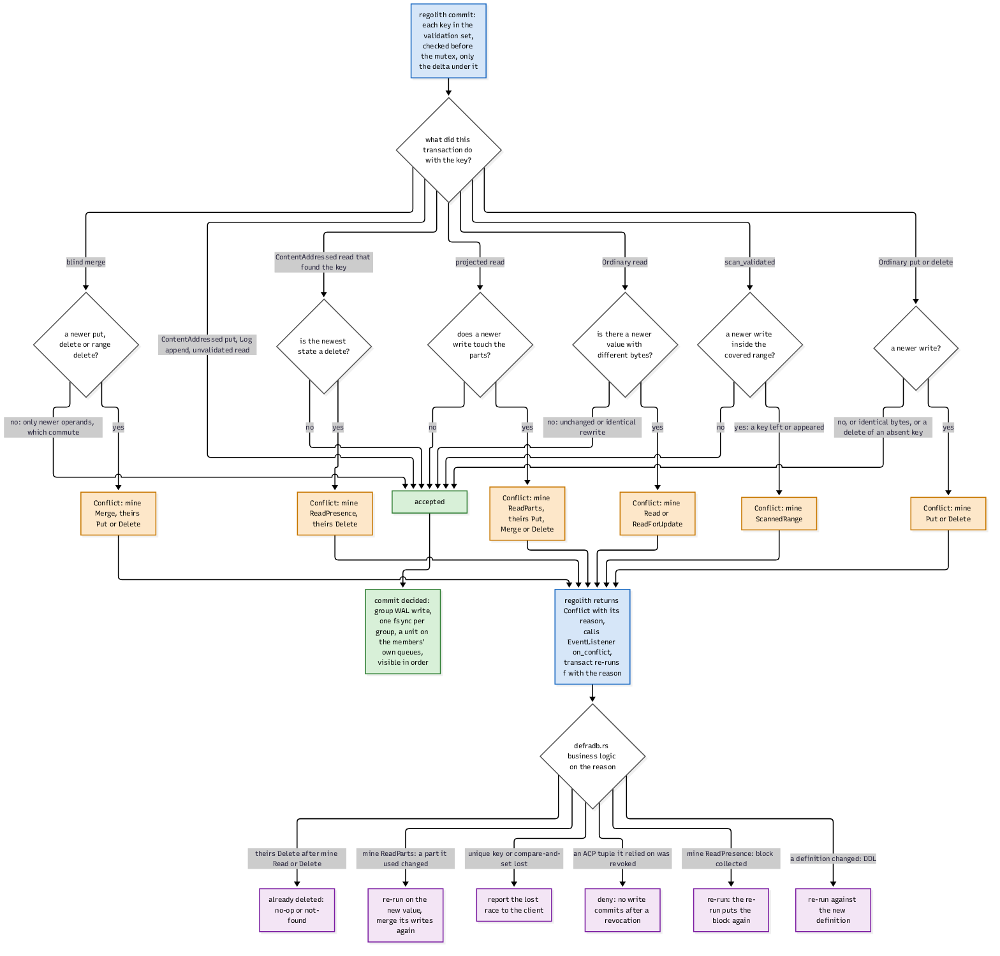

# Conflict rules

This chapter is the complete rule table: for each kind of interaction a transaction can
have with a key, what is validated at commit, what conflicts, and with which reason. The
engine applies these rules; defradb.rs picks its mechanisms so that the set of writes
that conflict with a decision is exactly the set of writes that could change that
decision.

## The rules, per interaction

The engine's commit walks every key in the validation set, checked before the critical
section (only the delta under it), and asks what *this* transaction did with the key:

| This transaction did | Conflicts with | Reason carried |
|---|---|---|
| a blind merge | nothing, if only newer operands follow (they commute); a newer put, delete or range delete | `mine Merge, theirs Put/Delete` |
| a ContentAddressed put | nothing (identical bytes are the same write) | - |
| a Log append | nothing (positions are engine-assigned) | - |
| an unvalidated read (`get_parts(key, &[])`) | nothing | - |
| a ContentAddressed read that found the key | only a newer delete | `mine ReadPresence, theirs Delete` |
| a projected read (`get_parts(key, parts)`) | a newer write touching those parts | `mine ReadParts, theirs Put/Merge/Delete` |
| an Ordinary read (`get` / `get_for_update`) | a newer value with different bytes (identical rewrite is not a change) | `mine Read/ReadForUpdate` |
| an Ordinary put or delete | a newer write (identical bytes, or deleting an absent key, are not changes) | `mine Put/Delete` |
| a validated scan | any newer write inside the covered range (a key left or appeared) | `mine ScannedRange` |

Every conflict carries the key, both sides' operations, and the commit sequences, and the
engine calls the `EventListener`'s `on_conflict` after every lock is released, which is
where conflict telemetry comes from.

## The consequences, in one paragraph each

**On document paths, almost nothing conflicts.** Field writes are blind merges of part
operands; head sets are blind set-operand merges; blocks are content-addressed; the
journal is an append. The races that remain are races defradb.rs *asks for*: one winner
per unique index key, per DocID mapping, per deletion marker, per definition, per ACP
tuple, per remote-block application, and per claim (two updates of the same parts).

**Delete-after-delete is the only conflict left on plain document paths.** Two deletes of
one document both read it as present; the second's validated read meets the first's
delete. The business logic answer is "already deleted: success as a no-op". (A blind
delete of an already-deleted key would not even conflict: it is elided.)

**Disjoint parts never conflict.** Worker 1 updates `title`, worker 2 updates `status`:
each did a projected read of its own parts, each wrote an operand touching its own parts,
`touches` says the operands do not meet, both commit. This is the mechanism that replaced
per-document write queues.

**Scans that decide are validated scans.** A claim queue, an ACP owner prefix, a
collection version scan: any newer write inside the covered range aborts the decision,
because the *set* of keys the decision covered has changed. Scans that merely yield (a
query's document scan) are not validated: phantoms do not matter to a snapshot read, and
a key the transaction then writes is validated as a read anyway.

> **Why identical bytes are not a change.** Validation exists to protect decisions, not
> to enforce an illusion of exclusivity. If the value a transaction would write is byte
> identical to what is already there, no decision anywhere could observe a difference,
> and reporting a conflict would be manufacturing an error. The same reasoning elides a
> delete of an absent key and lets two identical content-addressed puts both commit.
