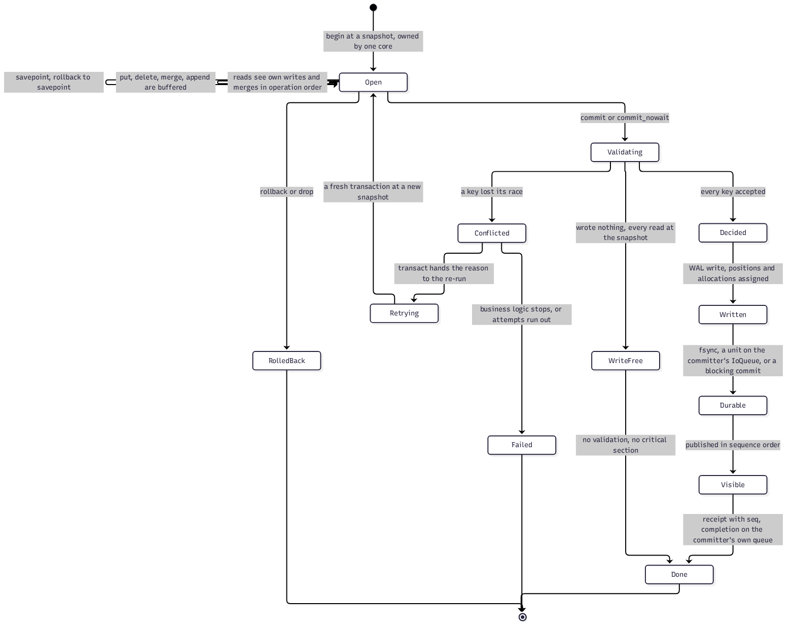

# Lifecycle and states

A defradb.rs transaction is an engine transaction (`regolith::Transaction`) wrapped in a
`DbTxn` ([`crates/db/src/txn/mod.rs`](https://github.com/sourcenetwork/defradb.rs/blob/main/crates/db/src/txn/mod.rs)) that adds the namespaced store views (datastore,
blockstore, headstore, systemstore, acpstore, peerstore), a transaction-scoped collection
catalog, and the statement savepoint machinery. The state machine it moves through:

## Open: reads see own writes, writes buffer

An explicit write transaction begins with `begin` at a snapshot and is *owned by one
core* for its whole life. Reads inside see the transaction's own buffered writes and
merges in operation order (read-your-own-writes), and `put`, `delete`, `merge` and
`append` are buffered in the transaction, not the memtable. Savepoints can be set,
rolled back to, and released, including the per-statement savepoints of an explicit
transaction.

A read-only transaction does not begin an engine transaction at all: it pins a snapshot,
which is the same view without commit-time validation nothing will ever ask for
([`crates/storage/src/backends/regolith/transaction.rs`](https://github.com/sourcenetwork/defradb.rs/blob/main/crates/storage/src/backends/regolith/transaction.rs)).

## Validating: the write-free fast path

At commit the engine validates the read set against newer commits. A transaction that
*wrote nothing* and read at one snapshot is write-free: no validation, no critical
section, done. This is not a corner case; it is every status read, every query without a
mutation, every arrival page. Concretely: a write-free attempt and a concurrent update of
the very rows it read *both* commit (there is a regression test that asserts exactly
this, `crates/storage/src/corekv/retry/`).

## Decided, written, durable, visible

A transaction that wrote something and kept every race:

1. **Decided**: sequences, log positions and allocations are assigned in group order.
2. **Written**: one WAL record for the whole commit group.
3. **Durable**: the group's fsync runs as a claimable unit on the members' own `IoQueue`s.
4. **Visible**: published in sequence order; each member's completion lands on its own
   queue; the receipt carries the commit sequence (`CommitReceipt.seq`).

## Conflicted: the re-run

When a key loses its race, the engine returns a typed `Conflict`, and the owning retry
loop (`transact`) re-runs the closure in a fresh transaction at a new snapshot, handing
it the reason. The closure is written to be re-runnable: everything with an outside
effect was prepared before it, and its decisions re-derive from the fresh reads. If the
business logic stops (a lost unique race reported to the client) or the attempts run out
(configured, default 5 re-runs), the transaction is Failed; otherwise it goes back to
Open.

Interactive (explicit) transactions differ in exactly one respect: they return their
conflicts to their caller instead of re-running automatically, and a failed statement
rolls back to its savepoint.

> **Why re-run instead of blocking.** A transaction that waits for the writer it raced
> holds a thread and a snapshot hostage. Re-running the closure at a fresh snapshot is
> optimistic concurrency: under contention the cost is a re-derive, not a stall, and the
> conflict reason usually lets the business logic finish in one re-run (or zero, when the
> answer is "already deleted").
