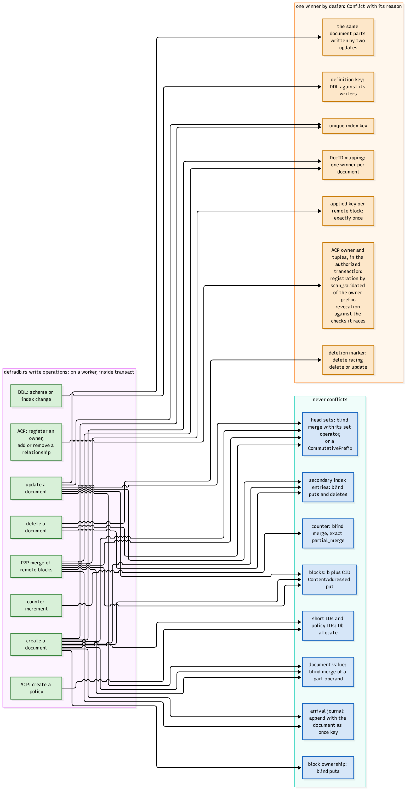

# Write scenarios

Every defradb.rs write operation, decomposed into its engine calls. Blue keys never
conflict; orange keys are races that need exactly one winner, surfaced as a typed
`Conflict`.

## Never conflicts

These writes commute, so concurrent writers never meet:

- **Blocks**: a `b`-prefix ContentAddressed put of the block's bytes keyed by its CID.
  Two writers of the same block write identical bytes: both commit.
- **Head sets**: one blind merge of a set operand per document
  (`add` per published head, `supersede` per consumed parent).
- **Document values**: blind merges of part operands (one operand per transaction
  holding its changed fields at their priorities).
- **Secondary index entries**: blind puts and deletes.
- **The arrival journal**: `append` with the document as its once key: the engine
  assigns the position in commit order and applies the once key exactly once.
- **Short IDs and policy IDs**: `Db::allocate`, the engine's atomic ID allocator.
- **Counters**: blind merges with an exact `partial_merge` (wrapping i64 addition).
- **Block ownership**: blind puts under `/d/b/{cid}/{docID}`.

## One winner by design

These writes race on purpose, and the loser gets a `Conflict` with a reason:

- **Unique index keys**: the second distinct value under a unique key loses.
- **The DocID mapping**: exactly one creator materializes a document; the loser re-runs
  and applies its blocks as operands.
- **Deletion markers**: delete racing delete or update produces the delete-after-delete
  no-op or the update-reports-not-found outcome.
- **Definition keys**: DDL against its writers; a schema or index change races every
  writer that read the definition to decide.
- **ACP owner and tuples**, inside the authorized transaction: registration is a
  validated scan of the owner prefix; revocation races the checks it invalidates.
- **The applied key per remote block**: exactly-once application of a replicated block.
- **The same document parts written by two updates**: the claim race; the loser re-runs
  and typically reports "not claimed".

## The operations, mapped

Where each operation's writes live in the code:

- **Create a document** ([`crates/db/src/write/autocommit/create.rs`](https://github.com/sourcenetwork/defradb.rs/blob/main/crates/db/src/write/autocommit/create.rs)): blocks + CID,
  head-set merge, the whole stored document, index entries, the journal append (once key:
  the doc), the short-ID and DocID mappings, block ownership, and the ACP owner
  registration.
- **Update a document** ([`crates/db/src/write/autocommit/update.rs`](https://github.com/sourcenetwork/defradb.rs/blob/main/crates/db/src/write/autocommit/update.rs)): new field blocks,
  head-set operand (supersede old heads, add new), one document part operand, index
  deltas for intersecting indexes.
- **Delete a document** ([`crates/db/src/write/autocommit/delete.rs`](https://github.com/sourcenetwork/defradb.rs/blob/main/crates/db/src/write/autocommit/delete.rs)): the deletion
  marker (ordinary key), index entry removals, a head operand, a delete block in the DAG.
- **P2P merge of remote blocks** ([`crates/db/src/merge/pooled.rs`](https://github.com/sourcenetwork/defradb.rs/blob/main/crates/db/src/merge/pooled.rs)): blocks, head sets,
  part operands, the applied key, the journal append, the DocID mapping.
- **Counter increment** ([`crates/crdt/src/counter.rs`](https://github.com/sourcenetwork/defradb.rs/blob/main/crates/crdt/src/counter.rs)): one blind merge; never a
  read-modify-write.
- **DDL: schema or index change**: definition keys against current writers.
- **ACP: register an owner, add or remove a relationship**: tuples in the same
  transaction the decision authorized.
- **ACP: create a policy**: a `Db::allocate`d policy id.

> **Why decompose writes this way.** Each key's conflict behaviour is chosen to be exactly
> as strict as the business question it answers. Unique constraints, existence decisions
> and authorization *must* have winners, so they are ordinary validated keys. Everything
> else commutes, so it is a merge, a content-addressed put, an append or an allocation:
> concurrent writers proceed in parallel, and the conflict rate of the workload, not the
> locking discipline of the database, is what it is.
